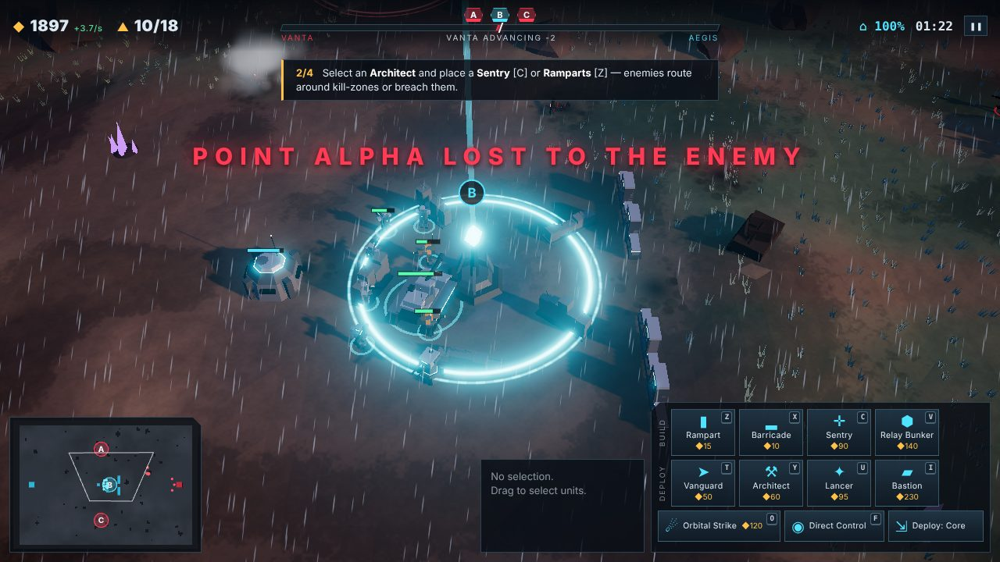
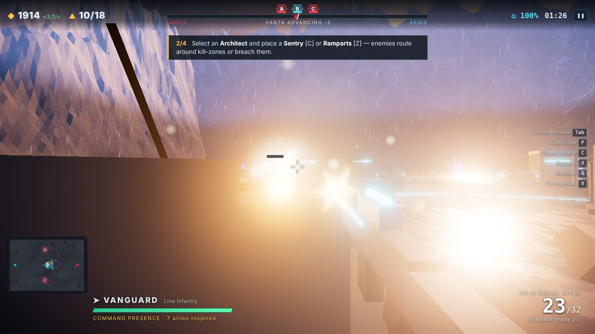
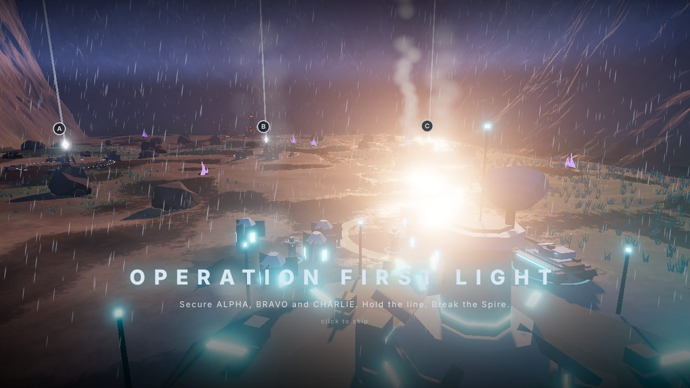
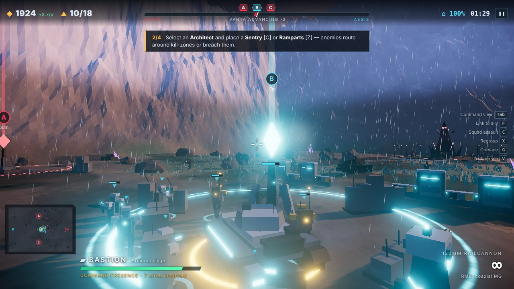

# FRONTLINE ARCHITECTS

**Command the war. Fight the battle.**

A 3D strategy-action game for the browser. You command an engineering army from above in
real time — and at any moment you can dive into the body of any soldier or vehicle and fight
in first or third person while the rest of the battle carries on without you.

Built with **Three.js**, **TypeScript**, **Vite** and **Rapier** physics. No backend, no paid
APIs, no asset downloads: every model, texture, particle and sound is generated in code.

| Commander Mode | Direct Control |
| --- | --- |
|  |  |
|  |  |

## Quick start

```bash
npm install
```

```bash
npm run dev
```

Open the printed URL (Chrome, Edge or Firefox on desktop; WebGL2 + WebAssembly required).

```bash
npm run build
```

```bash
npm test
```

`npm run build` type-checks and writes a static site to `dist/`. `npm run preview` serves it.

### Deploying to Vercel

The repo is a plain static Vite app and ships a `vercel.json` (`npm run build` → `dist`).
Import the repository in Vercel and deploy with the defaults; no environment variables are needed.

## The battle

Two factions — the **Aegis** engineering corps (you) and the **Vanta** collective — fight over
three capture points (ALPHA, BRAVO, CHARLIE) between their bases.

- Holding more points than the enemy pushes the **dominance bar** your way. Fill it and you win.
- Destroying the enemy **Spire** wins instantly. Losing your **Command Core** loses instantly.
- Every point you hold adds supply income **and** army capacity, and starves the enemy's reinforcement budget.
- The enemy escalates: bigger waves, heavier units, a counter-offensive when you are close to winning.

Three difficulties, a randomised battlefield layout each battle, and persistent records
(wins, losses, fastest victory per difficulty) give it replay value.

## Controls

### Commander Mode

| Input | Action |
| --- | --- |
| `LMB` / drag | Select unit / box-select. Double-click selects all of a type. `Shift` adds |
| `RMB` | Move · attack an enemy · send Architects to build or repair. `Ctrl+RMB` = assault-move (stop and fight) |
| `WASD` / arrows, wheel, `Q` `E` | Pan, zoom, rotate the camera (middle-drag also rotates) |
| `Z` `X` `C` `V` | Place Rampart / Barricade / Sentry / Relay Bunker. Drag to draw wall lines, `R` rotates, `Shift` keeps placing |
| `T` `Y` `U` `I` | Deploy Vanguard / Architect / Lancer / Bastion tank |
| `O` | Orbital strike (hits everything in the zone, friend or foe) |
| `H` | Hold position |
| `F` or `Tab` | **Take direct control** of the selected unit |
| `Ctrl+1…5` / `1…5` | Assign / recall control groups (press twice to jump the camera) |
| `Space` / `Home` | Jump to last alert / your base |
| `Esc` / `P` | Cancel placement / pause |

The minimap accepts left-click (move camera) and right-click (move order).

### Direct Control

| Input | Action |
| --- | --- |
| Mouse, `WASD`, `Shift`, `Space` | Look, move, sprint, jump (tanks: `W`/`S` throttle, `A`/`D` steer, mouse aims the turret) |
| `LMB` | Fire. `RMB` aims down sights (tank: coaxial machine gun) |
| `R` / `G` / `V` | Reload / grenade / toggle third person |
| `F` | **Link transfer** — jump straight into the ally under your crosshair |
| `C` / `X` | Order nearby allies to assault where you are looking / regroup on you |
| `1…4`, `LMB`, hold `E` | *Architect only:* pick a blueprint, place it, then build or repair it by hand |
| `Tab` | Return to Commander Mode (the unit goes back to its AI immediately) |

## How the systems connect

- **One simulation, two perspectives.** `World.update()` is ticked from a single place.
  Entering a unit only flips a `controlled` flag on it; orders, construction, enemy waves,
  capture and economy keep running. A test asserts exactly this.
- **Construction changes the map.** Structures are stamped into the navigation grid and into
  Rapier as colliders. Friendly units path around them; enemies either detour or decide a
  breach is cheaper and cut through. When a wall dies, paths and lines of sight reopen.
- **Cover is physical.** Shots are resolved with raycasts. Something solid just in front of a
  target absorbs most incoming fire — and takes the damage, so barricades get chewed up.
  Infantry on both sides look for cover that still gives them a firing line.
- **Turrets shape enemy routes.** Sentry coverage is written into a danger field the enemy
  pathfinder avoids, so walls plus turrets create real funnels — until Breachers and
  out-ranging Crawler tanks arrive, which the enemy builds *because* you fortified.
- **Relay Bunkers** move your reinforcement point to the front and heal nearby troops.
- **Command presence.** While you are embodied, allies near you fire faster and more accurately.
  Controlled units regenerate, take less damage, and aim as well as you do.
- **The enemy commander** scores objectives by value and by how well you defend them, counters
  your composition, reinforces contested ground, leaves pickets on captured points, pulls
  broken squads back to regroup with the next wave and assaults your Core when it has the mass.

## Project layout

```
src/
  core/         config (all balance numbers), Game loop & mode switching, events, rng, math
  sim/          World, UnitAI, Director (enemy commander), NavGrid (A*), CapturePoint,
                Formation, terrain — no rendering or DOM dependencies, runs headless
  physics/      Rapier wrapper: static colliders, raycasts, character controller, debris, grenades
  render/       Engine (renderer, sky, storm, post-processing), BattleView, Effects, procedural models
  input/        raw Input, CommanderController (RTS), DirectController (FPS / vehicle)
  ui/           HUD, minimap, 2D overlay, styles
  audio/        procedural WebAudio sound effects and generative score
  persistence/  settings and records in localStorage
tests/          vitest: navigation, formations, capture logic, headless battles, pacing guard
```

## Tests

`npm test` runs the simulation headless (Rapier included) and covers:

- A* routing around structures, re-opening after destruction, breach-vs-detour decisions, danger avoidance
- Formation slots and capture-point state machine
- Engineers building a wall that blocks movement and sight; destroying it restores both
- Move orders and territory capture
- The battle continuing while a unit is under direct control
- An unopposed enemy winning the battle (no stuck AI), and scripted-commander pacing on Recruit and Elite

## Known limitations

- Desktop keyboard + mouse only; no touch or gamepad support.
- One battlefield (obstacle layout is re-rolled each battle), no fog of war, no mid-battle save.
- AI units move on the navigation grid with separation steering rather than full rigid-body physics;
  Rapier drives the player's unit, projectiles' collisions, line of sight and debris.
- Vehicles use an arcade driving model. Unit animation is procedural and simple.
- All art is procedural low-poly geometry; no Blender/GLB assets were authored for this release.
- Audio is synthesised; there is no voice-over.
- The JavaScript bundle is ~5 MB (≈1.9 MB gzipped), most of it the Rapier WebAssembly build.
- Verified in Chromium. Other WebGL2 browsers should work but were not tested here.
